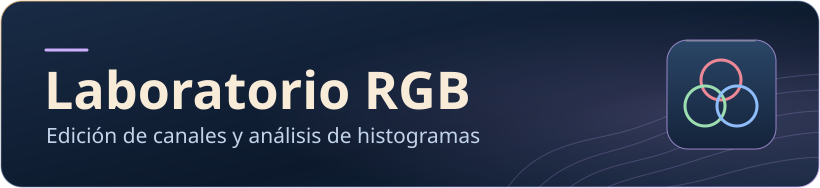
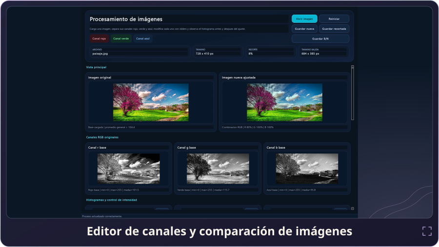
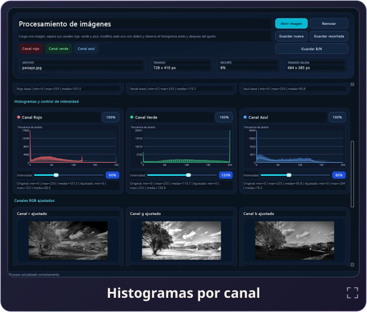
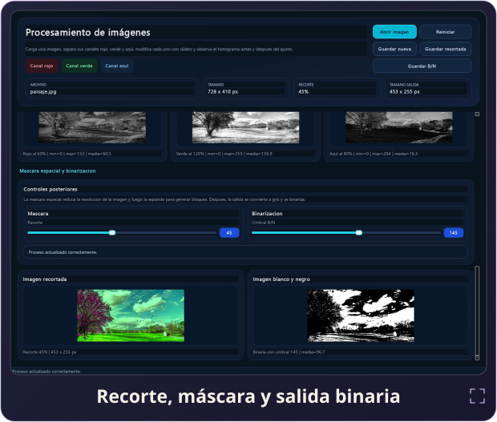

<p align="center">
  <picture>
    <source media="(prefers-reduced-motion: no-preference)" srcset="./docs/assets/banner-motion.svg">
    
  </picture>
</p>

<p align="center">
  <a href="#funcionalidades">Funcionalidades</a> · <a href="#tecnologías">Tecnologías</a> · <a href="#ejecutar-en-local">Ejecutar en local</a> · <a href="#capturas">Capturas</a>
</p>

Aplicación de escritorio para estudiar cómo cambian los canales de color al procesar una imagen. Permite comparar el original y el resultado, observar sus histogramas y guardar cada salida en un archivo independiente.

## Funcionalidades

- **Visualización por canal.** Separa rojo, verde y azul, con vista de cada componente e histograma.
- **Ajuste de intensidades.** Modifica cada canal de forma independiente y recompone la imagen RGB.
- **Comparación.** Muestra la imagen original y la ajustada junto con los histogramas de los canales.
- **Transformaciones.** Permite aplicar recorte central, máscara por bloques y binarización con umbral.
- **Guardado.** Exporta la imagen recompuesta, la variante recortada o la salida en blanco y negro.

## Tecnologías

| Tecnología | Uso |
| --- | --- |
| Python | Flujo de edición y operaciones de procesamiento |
| PySide6 y Qt | Ventana de escritorio, controles, gráficos y diálogos de archivo |
| OpenCV | Lectura, conversión de color, binarización y guardado de imágenes |
| NumPy | Ajuste de matrices de píxeles y cálculo de histogramas |

## Ejecutar en local

Necesitas **Python 3.10 o superior** y un entorno de escritorio con soporte para Qt. Ejecuta los comandos desde la raíz del repositorio.

**Windows, PowerShell**

```powershell
python -m venv .venv
.\.venv\Scripts\python.exe -m pip install -r requirements.txt
.\.venv\Scripts\python.exe main.py
```

**macOS o Linux**

```bash
python3 -m venv .venv
.venv/bin/python -m pip install -r requirements.txt
.venv/bin/python main.py
```

## Primer recorrido

1. Pulsa **Abrir imagen** y selecciona un archivo local. Puedes usar [`salidas/paisaje.jpg`](salidas/paisaje.jpg) como ejemplo.
2. Mueve los controles de intensidad de los canales y compara los histogramas del original con los del resultado.
3. Ajusta el recorte y el umbral de blanco y negro. Revisa las vistas de salida.
4. Usa **Guardar nueva**, **Guardar recortada** o **Guardar B/N** según la salida que quieras conservar. El diálogo propone la carpeta `salidas/`.

## Estructura

- [`main.py`](main.py) inicia la aplicación.
- [`window.py`](procesamiento/window.py) define la ventana principal y el flujo de edición.
- [`widgets.py`](procesamiento/widgets.py) contiene paneles, histogramas y controles de canal.
- [`imaging.py`](procesamiento/imaging.py) implementa operaciones de color, píxeles y archivos.
- [`requirements.txt`](requirements.txt) lista las dependencias de Python.

## Capturas

<p align="center">
  <a href="./docs/assets/capturas/rgb.png"></a>
</p>

<p align="center">
  <a href="./docs/assets/capturas/rgb-histogramas.png"></a>
  <a href="./docs/assets/capturas/rgb-mascara.png"></a>
</p>
